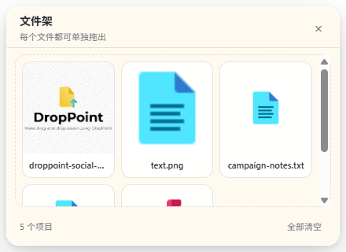

# DropPoint FileShelf

一个常驻桌面、始终置顶的临时文件架。把文件或文件夹拖进窗口后，每个项目都会成为一张独立卡片；需要上传或发送时，可以把任意一张卡片拖到浏览器、聊天工具或其他支持系统文件拖放的应用中。

> 这是独立桌面程序，不是 Chrome 扩展，不依赖任何网站，也不会向外部服务上传你的文件。



## 为什么做成桌面程序

浏览器扩展模拟文件拖放时会受到网页框架、权限和浏览器安全策略限制。DropPoint FileShelf 直接使用 Electron 的原生文件拖放能力，因此可以跨浏览器、跨标签页，也能用于微信、企业聊天工具、邮件客户端和其他桌面应用。

## 功能

- 文件和文件夹集中放在同一个置顶窗口中，但每个项目保持独立。
- 单张卡片独立拖出；拖出后仍保留，可重复使用。
- 图片显示本地缩略图；文件夹、文本、音频、视频和其他文件显示类型图标。
- 支持单独移除卡片或一键清空整个文件架。
- 文件名过长时自动截断，完整名称保留在悬停提示和无障碍标签中。
- 保留 DropPoint 的系统托盘、多窗口和全局快捷键能力。
- 提供 Windows NSIS 安装包和 ZIP 构建配置。
- 包含 Electron 启动、文件卡片、单项拖出和退出流程的 Playwright 测试。

## 使用方法

1. 启动 DropPoint FileShelf。
2. 将一个或多个文件、文件夹拖入窗口。
3. 在文件架中找到目标卡片，把它拖到浏览器上传区或其他应用。
4. 点击卡片右上角的 `×` 只移除该项目；点击“全部清空”清除当前列表。
5. 通过系统托盘新建文件架窗口、打开设置或完全退出程序。

清除卡片只会移除文件架中的引用，不会删除电脑上的原文件。

## 环境要求

- Node.js 22 LTS（`>=22.12.0`）
- npm
- Windows 10/11、macOS 12+ 或现代 64 位 Linux

当前版本主要在 Windows 上完成构建和自动化验证。

## 本地运行

从 Tearice 合集仓库运行：

```powershell
git clone https://github.com/tonyzaca7755963/Tearice.git
cd Tearice/DropPoint-FileShelf
npm ci
npm start
```

开发模式默认创建一个 `440 × 320` 的置顶文件架窗口。

## 测试

运行完整自动化测试：

```powershell
npm test
```

生成真实 Electron 窗口的视觉状态截图：

```powershell
npm run visual:qa
```

截图和 JSON 报告会生成到 `test-results/visual-qa/`，该目录不会提交到 Git。

## 构建

```powershell
npm run build
```

构建产物位于 `dist/`，Windows 文件名采用以下格式：

```text
DropPoint-FileShelf-<version>-win-<arch>.exe
DropPoint-FileShelf-<version>-win-<arch>.zip
```

`dist/` 是本机构建目录，不纳入源码仓库。

## 项目结构

```text
DropPoint-FileShelf/
├── build/                  # Electron Builder 图标和打包资源
├── docs/                   # 上游贡献说明及本项目截图
├── renderer/               # 文件卡片状态模型和渲染逻辑
├── src/                    # Electron 主进程、preload、托盘与设置
├── static/                 # 窗口 HTML、CSS 和文件类型图标
├── test/                   # Playwright、模型与视觉 QA 测试
├── DESIGN.md               # 界面设计契约
├── NOTICE.md               # 上游来源与版权说明
└── package.json            # 脚本、依赖与打包配置
```

## 实现说明

- 主进程负责窗口、系统托盘、全局快捷键与 Electron 原生 `startDrag`。
- preload 使用 Electron `webUtils.getPathForFile()` 取得用户主动拖入文件的本地路径。
- renderer 为每个路径创建独立卡片，并在拖出时只向主进程传递当前卡片。
- 图片预览使用本地 Object URL，并在移除或关闭窗口时回收。
- 应用不会把文件内容上传到服务器；依赖安装、更新检查或用户自行增加的功能可能产生普通网络访问。

## 当前限制

- 文件列表仅保存在当前窗口会话中；关闭窗口后不会恢复。
- 窗口尺寸当前固定为 `440 × 320`，文件较多时在卡片区域滚动。
- 仅图片生成缩略图，其他格式使用类型图标。
- 能否拖入目标应用取决于对方是否接受操作系统文件拖放。
- 本仓库不提交预编译安装包；请从源码构建。

## 上游与许可证

本项目基于 [GameGodS3/DropPoint](https://github.com/GameGodS3/DropPoint) 修改，当前改造基线为上游提交 `137789d`。主要改动是将原先的合并文件堆栈重构为可识别、可单独移除和拖出的文件卡片，并升级 Electron 运行与测试链路。

- 上游项目：GameGodS3/DropPoint
- 上游作者及贡献者：以原仓库历史为准
- 本修改版许可证：GNU GPL v3 或更高版本
- 完整条款：[LICENSE](./LICENSE)
- 来源说明：[NOTICE.md](./NOTICE.md)

分发本项目的修改版或二进制文件时，请遵守 GPL 要求，同时提供对应源代码、许可证和修改说明。

## 致谢

感谢 DropPoint 原作者与所有上游贡献者。本项目继续使用上游的拖放架构、托盘能力和部分图标资源。
